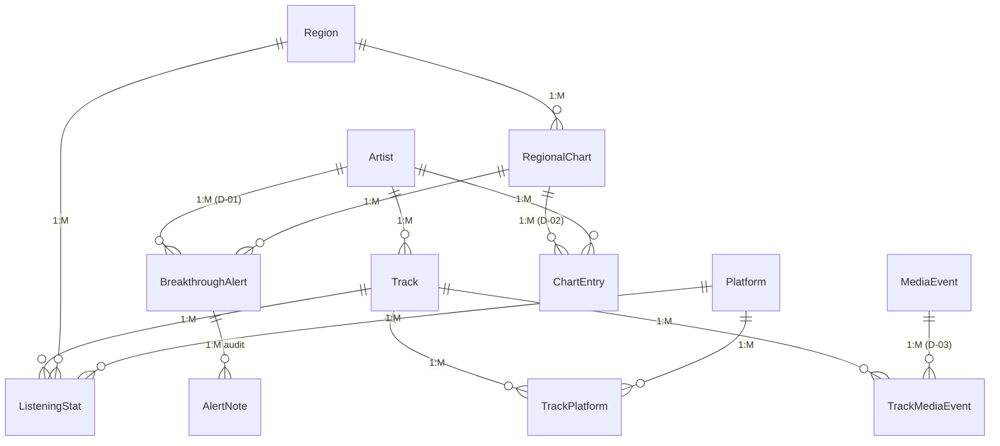

# Доменная модель v2

## ER-диаграмма (Mermaid — рендерится в GitLab и Notion)

D-01. Alert: M:1 к Artist, статус-машина вместо булева флага — прорывов у артиста несколько, у алерта есть workflow.
D-02. ChartEntry реляционно, не snapshot_json: «позиция в неделе N» — это SQL, а не парсинг blob.
D-03. Junction с атрибутами: available_since делает «каталог давно в доступе» измеримым; link_type различает soundtrack и UGC.
D-04. ISRC — natural key: каталоги площадок матчатся по нему, external_id живёт в TrackPlatform.
D-05. ListeningEvent в MVP = недельный батч listening_stats; в бою — сырые события с партиционированием по месяцам, retention 24 мес.
**D-06. Истинная база ≠ наблюдаемая база.**
`Artist.true_total_plays` — сумма по всему горизонту, независимая от сбросов счётчиков.
Наблюдаемая база вычисляется на текущую неделю с учётом `rights_week` и полноты данных.
Разделение введено после того, как валидатор сида выявил расхождение: демо-алерт
утверждал «истинная база > 50k», тогда как хранимое поле содержало сумму лишь до
стартовой недели. Инвариант «активный SLEEPER ⇒ база < max_plays» добавлен в самопроверку.

**D-07. Исторические чарты неизменяемы.**
Чарты недель 1…START_WEEK фиксируются при инициализации и не пересчитываются:
lookback-признак должен опираться на зафиксированный факт, а не на пересчёт задним числом.

**D-08. Типизация фикстур.**
Описания артистов/треков/событий переведены с нетипизированных dict на frozen dataclass.
Причина: статический анализатор не мог гарантировать хешируемость ключа (`d["id"]`),
что маскировало потенциальные ошибки обращения к полям. Типизированные фикстуры
дают автодополнение и раннее обнаружение опечаток в именах полей.

**D-09. База оценивается в окне ДО детекции, а не за всю историю.**
Признак «артист был непопулярен» вычисляется как сумма прослушиваний за
`baseline_weeks` (default 8) недель, предшествующих текущей. Причина: при сумме
за весь горизонт артист, совершивший прорыв, автоматически перестаёт удовлетворять
порогу «база < 50 000» — правило дисквалифицирует собственные положительные случаи.
Дефект выявлен валидатором сида: демо-артист SLEEPER имел тотал 211 377 при пороге 50 000.
Разделены `baseline_plays` (наблюдаемая, с учётом FR-04/FR-05) и `true_baseline` (истинная).

**D-10. Порог «был популярен» масштабируется под каталог.**
`popular_rank` (прод: 50, демо: 5). При каталоге из 12 артистов позиция физически
не превышает 12, поэтому жёсткий Top-50 делал FR-01/FR-02 несрабатывающими.
Порог вынесен в конфигурацию вместе с остальными (NFR-02).

**D-11. Изоляция тестовых данных.**
Контрактные тесты API работают на in-memory SQLite через `dependency_overrides[get_db]`,
а не на файле демо-БД. Причина: тест статус-машины мутировал `AL-1043` в демо-наборе,
после чего повторный прогон проверял уже другой переход и давал ложный результат.
Фабрика батчей сделана идемпотентной (upsert по week+artist+region), что снимает
конфликт UNIQUE при переопределении недели в фикстуре.