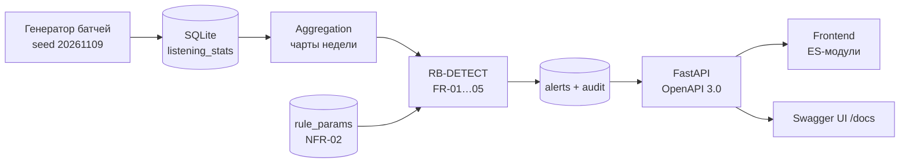
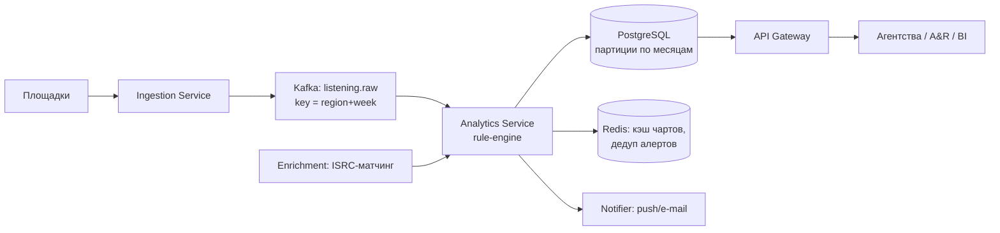

# Архитектура

## MVP (реализовано)

## Целевая (боевой путь)

## Обоснование решений
**Kafka:** пиковые батчи 50 млн событий/нед сглаживаются очередью; consumer groups масштабируют агрегацию горизонтально.
**Redis:** чарт читается на два порядка чаще, чем пересчитывается; дедупликация алертов с TTL 8 недель.
**SQLite → PostgreSQL:** MVP не требует сервера БД; переход = смена DATABASE_URL и партиционирование listening_stats (NFR-03).
**FastAPI:** контракт OpenAPI генерируется из кода — документация не расходится с реализацией.
Масштабирование кода
Новое правило = функция в services/rules.py + запись в docs/03 + тест AC.
Новый эндпоинт = роутер в api/ + схема в schemas.py.
Новое представление фронтенда = модуль в js/views/ + пункт роутера.