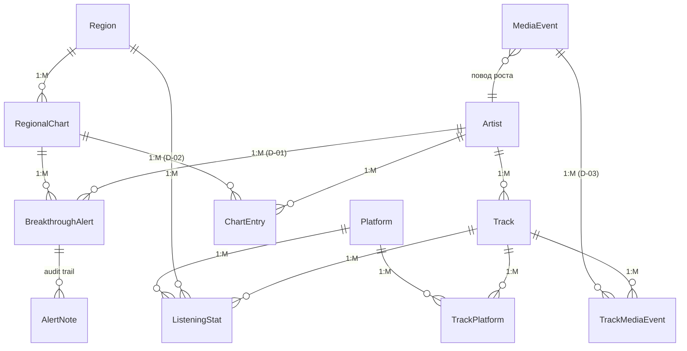
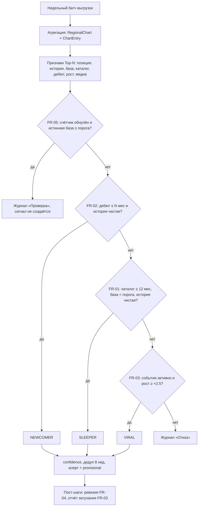
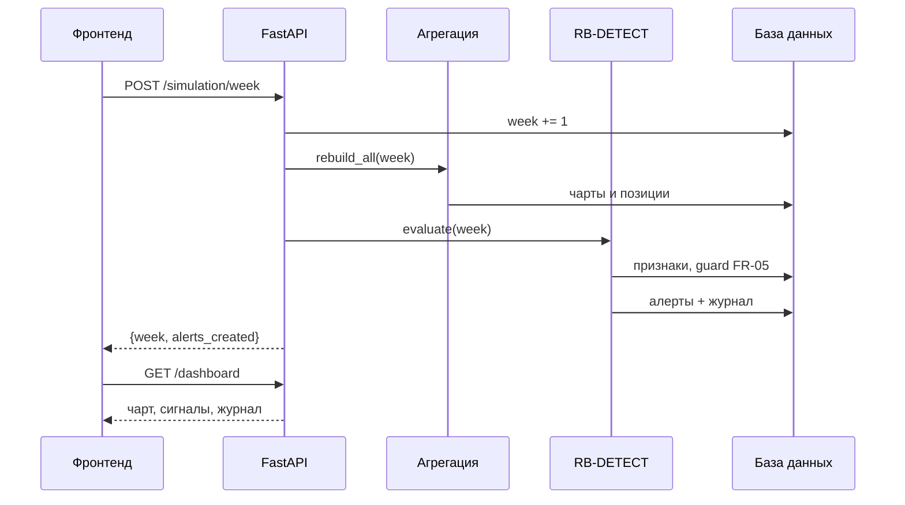
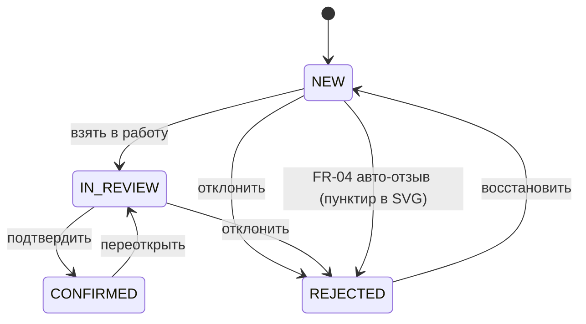
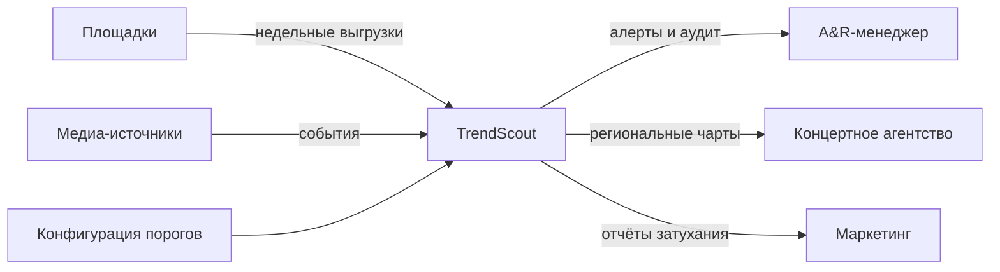

# Диаграммы · исходники для правки

SVG-файлы в `docs/diagrams/` собраны из этих источников. Mermaid рендерится
в GitLab и Notion без дополнительных инструментов.

## ER-диаграмма

## Алгоритм RB-DETECT

## Последовательность: недельный цикл

## Статус-машина

## Контекстная диаграмма потоков данных

